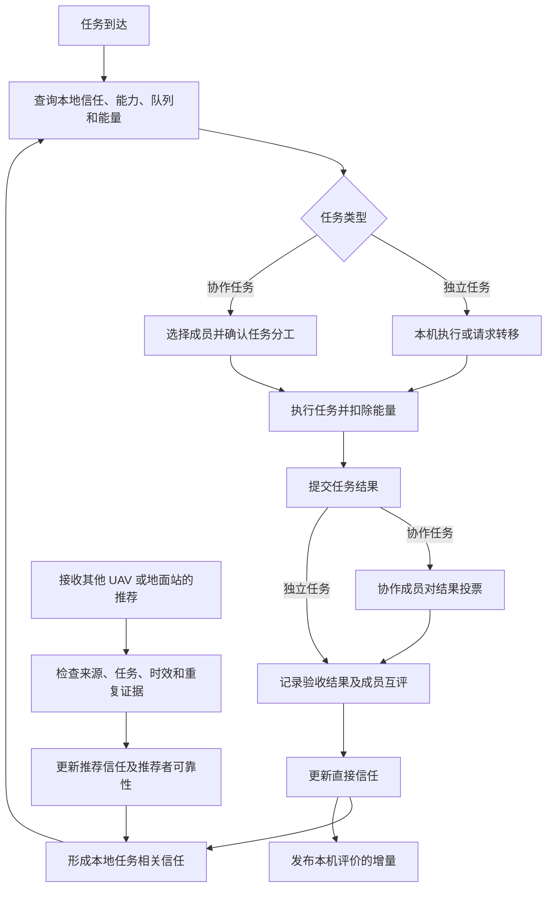
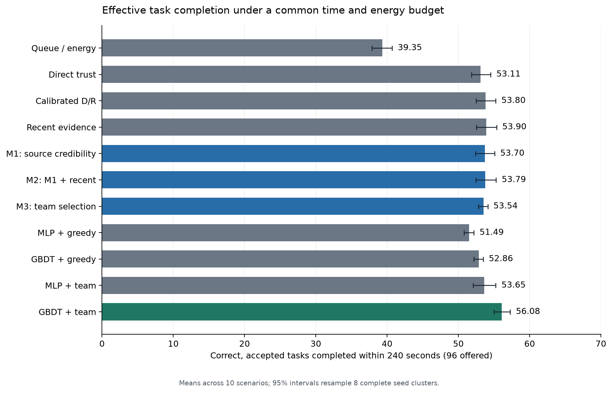

# 端侧 Agent 驱动的 UAV 协作信任与任务调度方案

更新日期：2026-10-12。

**目标：在相同时间、能量和通信预算下，让无人机群完成更多完整正确且通过验收的任务。**

每台 UAV 配备一个 Agent，维护结构化的本地交互上下文和信任表。信任依据分为直接经验和他人推荐，
用于选择任务转移对象、协作成员及后续参与资格。协作完成后，成员对任务结果投票，并相互评价。

本文件区分三种状态：已明确的任务规则、已经在独立任务级仿真中实现的机制、尚待验证的研究方向。
它不替换仓库当前的旧版 MTIM 论文，也不表示已经实现实机分布式部署或多智能体强化学习。
本次发布方案和小型结果快照；完整任务模拟器、训练权重及原始轨迹尚未在此文档更新中发布。

## 1. 当前设计主线



图中成员协商、地面站参与及真实消息协议是目标接口。当前仿真使用原子接单、进程内消息总线和理想结果核验器；
所有请求仍由 UAV-0 发起，各节点保存独立状态，但未成为能够独立发起任务和协商的端侧进程。
独立任务由执行结果验收；三人/五人协作才进入成员投票。

## 2. 已确定的任务规则

| 任务类型 | 处理方式 | 验收规则 |
|---|---|---|
| 独立任务 | 本机处理；队列较长时，可转移给满足信任、能力和能量要求的节点 | 检查提交、正确性和截止时间 |
| 三人协作 | 三名成员分别执行约定工作，完成后对结果投票 | 至少 1 张反对票即验收失败 |
| 五人协作 | 五名成员分别执行约定工作，完成后对结果投票 | 至少 2 张反对票即验收失败 |

投票发生在执行和结果收集之后。任务结果投票与成员互评是两件事：前者决定验收是否通过，后者为后续信任提供证据。
缺失结果、迟交结果和反对票分别记录。缺票不能静默当作反对票；当前模拟器尚未实现网络导致的缺票。

每次协作最多产生 n(n-1) 条有向互评，即三人 6 条、五人 20 条，不允许自评。
任务转移需要唯一任务编号、接单确认、唯一执行归属及超时恢复；现有仿真仅用原子预约模拟这一过程。

## 3. 每个 Agent 的结构化上下文

### 3.1 本地上下文

| 信息 | 例子 | 作用 |
|---|---|---|
| 任务与交互 | 请求、接单、提交、回执、超时、任务依赖 | 判断履约情况 |
| 执行与资源 | 能力、剩余能量、队列、预计完成时间 | 判断当前可用性 |
| 协作证据 | 成员分工、个人贡献、结果票、评价理由 | 区分成员责任 |
| 推荐证据 | 谁评价谁、对应哪个任务、何时发布、证据引用 | 使用第三方意见 |
| 证据状态 | 有效样本量、缺失、时效、是否独立核验 | 表达未知和不确定性 |

低能量和长队列影响任务准入，不直接表示不诚信。单个总信任分数不应无差别控制所有任务和权限。
目标是分别表征执行可靠性、投票可靠性和推荐可靠性，同时保留直接/推荐两类证据来源。

### 3.2 信任表与消息接口

一行信任表表示“观察者 i 对目标 j 在某类任务中的当前评价”，不是全网统一结论。建议字段如下：

```text
observer_id, subject_id, task_scope
direct_trust, recommended_trust, combined_trust
execution_reliability, voting_reliability, recommender_reliability
effective_evidence_count, evidence_state, updated_at
```

推荐消息还应绑定 `task_id`、时间、有效期、序号和证据引用。签名是后续协议要求；当前仅假设消息来源已认证，
没有实装密码签名。来源认证只能证明发送者身份，不能证明评分真实。

传播采用评价增量，不反复广播整张表。重要状态变化触发更新，周期同步用于检查过期和缺失。
收到的意见与本地直接证据分开存储；多个转述引用同一任务或同一证据时，不视为多个独立样本。

## 4. 当前信任计算与改进方向

### 4.1 直接信任与推荐信任

本地 i 亲自观察 j 的行为形成直接信任 D(i,j)。k 将其评价发送给 i 时，对 i 而言是推荐证据，用于 R(i,j)。
当前基础版本按提交、按时履约、核验结果及投票一致性产生 0/1 交互评分 s，采用先验平滑：

`D(i,j) = (1 + sum(s)) / (2 + n)`

普通推荐先在同一任务内平均，再按任务聚类平滑；已经有本地直接证据的同任务推荐不重复计入。
综合信任限制推荐的影响，直接经验增加时推荐比例降低。无有效证据标为未知，不以缺失值代表恶意。

这些是可解释的基线规则，不是已经证明优于既有信任模型的新算法。分数也不能未经验证解释为恶意概率。

### 4.2 已实现的 M1–M3

| 版本 | 机制 | 当前边界 |
|---|---|---|
| M1 | 对照同一任务的可核验证据评价推荐者，再按其可靠性融合推荐 | 缺少可比较证据时不核验；不是多数表决识别说谎者 |
| M2 | M1 加近期交互窗口，使新违规和新正面证据影响评分 | 已实现最近 4 次证据；主动恢复试探、完整状态滞回尚未实现 |
| M3 | 分别估计履约和投票行为，按照三人/五人否决规则选择团队 | 使用条件独立的可靠性代理，没有抗任意串谋的风险保证 |

推荐者在同一任务上对多个成员的声明只形成一个有效信誉事件，避免人为放大证据量。
核验必须使用同一事件、相容观察范围的证据；不能用目标在另一时段的表现反推旧推荐者一定说谎。
正常执行任务不能自动证明推荐诚实，但限制评价影响与限制执行资格应按职责分别考虑。

## 5. 攻击与正常故障

| 层次 | 当前可配置行为 |
|---|---|
| 执行 | 接单不执行、延迟提交、提交错误贡献 |
| 结果投票 | 无条件反对、否决正确结果、认可错误结果 |
| 推荐 | 诬告正常节点、给同伙虚假好评、互捧与诬告组合、重复发送同一评价 |
| 攻击时机 | 预热后开始、周期性切换、仅关键任务、概率性激活 |

正常不提交、正常迟交、正常错误产出作为配对对照。如果正常故障和恶意破坏产生相同可观测信息，
信任算法不能仅凭这些信息辨识意图。低履约分可支持限制某些任务，但不能自动宣称识别了恶意身份。

实际结果是否正确与投票是否通过分别记录。合理反对错误结果不受恶意否决惩罚；协作失败不自动惩罚全部成员。
模拟器的攻击名单、私有原因和事后审计标签不能进入在线 Agent 的输入。

当前没有加入 Sybil、身份冒充、真实无线干扰、战略性最优攻击、资源快照伪造或真实网络转移协议。
这些扩展需要单独的身份、通信和威胁模型，不能仅通过改攻击标签声称已经覆盖。

## 6. 能量和任务调度

接单前检查剩余能量、已经预约的能量、安全余量和截止时间。任务转移比较传输、排队和执行成本。
执行、投票、互评、推荐发送/接收以及核验均按配置记账。失败任务已经执行的工作仍消耗能量。
不执行者节约的功耗不算系统效率提高；任务拒绝也必须保留在任务总数中。

当前能耗是任务级参数模型，不是实测飞行功耗。独立 ns-3 3.41 Wi-Fi/UDP 探针已在本地跑通，
但 ns-3 尚未耦合任务引擎。推进、空闲耗电和真实端侧推理能耗仍需后续测量。

## 7. 以完成更多任务为主指标

定义 `effective_completed_tasks`：在共同时间窗口 H 内，完整正确、通过验收且满足任务截止时间的任务数量。

`N_eff(H) = sum(产出完整正确 AND 验收通过 AND 完成时刻 <= min(任务截止时间, H))`

本轮固定 H=240 秒，每次 96 个任务，8 台 UAV，每台初始能量 350 J，安全余量 15 J。
单人/三人/五人任务按固定比例轮换；每位参与者执行 6 秒，公开结果收集宽限为 3 秒。
拒绝、超时、缺失、错误结果及验收失败不计成功，所有提供的任务都保留在完成率分母中。

辅助指标包括接单覆盖率、有效任务/分钟、有效任务/焦耳、延迟、错误结果被接受、正确结果被否决和计算开销。
任务数量不等于按任务价值或工作量加权的产出，后续需要明确真实业务目标。

## 8. 已完成的实验及真实结论

实验按完整运行划分训练、模型选择、策略校准和测试。最终测试包含 8 个新 seed、10 个场景、11 种策略，
共 880 次对照运行；它们并非 880 个独立环境 seed。所有方法使用相同任务、能耗和投票规则。
模型和门槛先锁定，测试轨迹随后生成。小型证据快照见 [evidence/](evidence/README.md)。

每次 96 个任务的平均结果如下：

| 策略 | 有效完成任务数 | 有效完成率 |
|---|---:|---:|
| 队列/能量，不用信任选人 | 39.35 | 40.99% |
| 校准后的直接/推荐融合 | 53.80 | 56.04% |
| 简单近期证据 baseline | 53.90 | 56.15% |
| M1 推荐者可靠性 | 53.70 | 55.94% |
| M2：M1 + 近期证据 | 53.79 | 56.03% |
| M3：分职责估计 + 团队选择 | 53.54 | 55.77% |
| MLP + 同样的团队选择 | 53.65 | 55.89% |
| GBDT + 同样的团队选择 | **56.08** | **58.41%** |

**本轮 M1–M3 没有超过强 baseline，也没有建立相对校准旧方法的总体优势。**
M3 比校准阶段预先选定的 GBDT+团队搜索平均少完成 2.5375 个任务；按完整测试 seed 聚类的
95% bootstrap 区间为 [-3.4625, -1.7625]。该区间不包含重新采样训练数据的不确定性。



M3 在持续执行破坏场景有所改善，但在无攻击、持续否决正确结果等条件下退化。
相同证据快照上的后续诊断显示，手工履约/投票可靠性代理的预测误差高于 GBDT；组队代理也可能牺牲正常吞吐。
这些失败结果需要保留，不能通过删场景、改方法名或测试后调门槛制造优势。

本地验证记录为 69 项测试通过，独立核验 84,480 个任务记录、104,656 张结果票及 651,012 次核验计费。
这里发布的是运行结果快照；完整代码、权重和原始轨迹未包含在本次文档更新中，不能仅凭快照重跑实验。

## 9. 人工智能与深度学习的下一步路线

目前已经训练同特征的 MLP 和 GBDT，分别预测个人履约成功和正确产出上的赞成行为。
它们不是直接输出有安全保证的恶意概率。当前可用的最强参考是 GBDT+团队选择。

候选深度学习流程为：


**GRU、GNN、GAT 和时序图模型均为待实现、待验证方向。**

- UAV 是图节点；“谁评价谁”是有向边，边携带任务、时间、证据范围和核验信息。
- 节点能量、队列和能力描述可用性；不能直接等同于诚信。
- 时序编码用于识别先正常合作、随后选择性破坏的行为。
- 图模型用于利用局部互评关系，但注意力权重不自动代表可信度，也不自动提供抗串谋能力。
- 先比较同历史信息的 GRU，再增加图层，验证额外收益。保留强 GBDT、MLP 和简单时序 baseline。
- 每机 Agent 是观察、决策和执行的载体；是否使用 LLM 是独立选择，目前并无采用 LLM 的必要性证据。

未来多请求者、局部观察与动作反馈实现之后，才适合系统比较 MARL 策略。当前原型不能仅因有多个 Agent 对象就称为 MARL。

## 10. 下一轮实验与研究边界

1. 优先改善投票风险估计与全局队列吞吐，验证是否真正增加有效完成任务。
2. 在相同输入、核验预算和资源限制下比较信任估计器；比较调度器时固定信任估计器。
3. 增加不完整/延迟核验、正常故障、策略性否决和串谋；明确哪些情况不可辨识。
4. 实现多请求者自主任务发起、异步协商和预约撤销，再验证端侧 Agent 的实际分布式作用。
5. 本轮测试已用于诊断；根据它修改方法后，另留新的最终测试 seed 与条件。
6. 发布匹配版本的完整代码、环境、权重和轨迹后，再形成完整复现包。

每机 Agent、直接/推荐信任、图结构和经典阈值可靠性公式本身不构成已确认的新颖性。
候选贡献应具体落在“不可靠局部互评下、面向不同任务否决阈值的有效组队与任务转移”，并由公平对照支撑。

## 11. 参考工作与核验范围

- [GDM-DTM，2025](https://doi.org/10.3390/s25133982)：已核对原文的多视角一致性、分歧处理与反馈机制；
  实验采用消息篡改和假信息生成，不能直接当作本项目的投票破坏模型。
- [TRAVOS，2006](https://doi.org/10.1007/s10458-006-5952-x)：直接经验、第三方声誉及不准确推荐来源的相关工作；
  当前原型并未完整复现该算法。
- [GALTrust，2024](https://doi.org/10.1109/TCE.2024.3384978)：已确认摘要描述 GAN、type-2 fuzzy logic 和 trust redemption；
  具体攻击注入细节尚未从全文核实，不能声称当前适配器就是其原算法。
- [Revisiting Deep Learning Models for Tabular Data，2021](https://arxiv.org/abs/2106.11959)：用于强学习 baseline 和统一比较协议的参考。

本文件是研究方案与阶段性证据记录，不承诺优于全部 baseline、已解决任意串谋，或具备实机防护保证。
